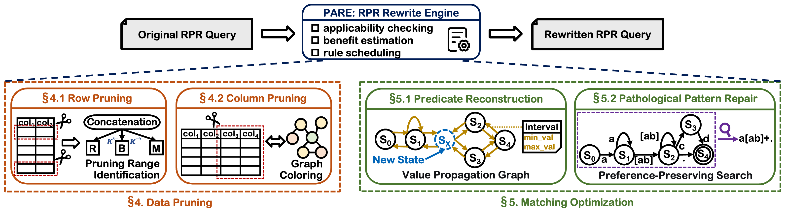

# Query Rewriting for Row Pattern Recognition

## 1. Introduction
In 2016, the International Organization for Standardization (ISO) introduced row pattern recognition (RPR) in SQL to enable detecting ordered sequences of rows that match specific patterns [1].
Over the past decade, several database and data stream systems (e.g., Oracle, Trino, IoTDB, Snowflake, Azure Stream Analytics, Amazon Athena, and Flink) have implemented RPR functionality.

However, **RPR queries often incur substantial execution overhead, primarily due to expensive sorting operations and pathological patterns that trigger excessive matching and backtracking.** 
These two sources of overhead, unfortunately, remain largely under-explored in existing optimization research [2, 3]. 

This project aims to formulate rewrite rules for RPR queries while explicitly establishing their boundaries of applicability. 
This is a non-trivial undertaking, requiring in-depth study of the SQL standard alongside extensive testing. 
To ensure good extensibility, we developed the query rewriting plugin around a dedicated Abstract Syntax Tree (AST) for RPR queries. 
Ideally, the resulting query-rewriting mechanism is database-agnostic: the queries it generates already run seamlessly on both Oracle and Trino, and porting to IoTDB requires only the translation of specific clauses—for example, mapping the `FIRST` function to `RPR_FIRST` (please refer to [IoTDB User Guide](https://iotdb.apache.org/UserGuide/latest-Table/User-Manual/Pattern-Query_apache.html)). 
We hope [these rewrite rules](./rewriting_rules/) offer valuable insights for RPR optimization.


## 2. Our Method 

We present PARE, a **p**attern-**a**ware **r**ewriting **e**ngine that transforms an RPR query into a cheaper, semantically equivalent one.
PARE's design follows from where the cost of an RPR query comes from.
`MATCH_RECOGNIZE` operator first partitions and sorts its input, and then runs the pattern matcher over each sorted partition.
Thus, the total cost has two parts: 
(1) the volume of data that is sorted and scanned, determined by the number and the width of the input rows; 
and (2) the matching effort per row, determined by how many candidate transitions the matcher explores and how often it backtracks.
PARE targets these two parts with two complementary groups of rewrites: *data pruning* and *matching optimization*.

<!--  -->



The source code is available in [our_method.py](./our_method.py), where each rewrite rule is classified under one of the PARE optimization ideas (see `RULE_PIPELINE=(...)`). The relatively large number of rewrite rules is intentional: for certain simple patterns, we implemented dedicated rewrite rules to enable fast rewriting.

## 3. Code Execution Instructions

### Running SQL Workload

As an example, consider running the SQL workload on the ["CRIMES" dataset](https://data.cityofchicago.org/Public-Safety/Crimes-2001-to-Present/ijzp-q8t2) using Trino 483 and PostgreSQL 18.6:

Once you have installed and started the required database system (if you are unsure how to download it, an LLM agent, e.g., codex, can handle this entire process for you), please execute the following command to insert the data:

```shell
python experiments/import_crimes_postgresql.py
```

After the data insertion is complete, run the following command to obtain the execution results for the original queries:

```shell
# windows shell command
python experiments/run_crimes_queries_trino.py `
  --query-file data/crimes_sql.json `
  --output-dir experiments/trino_crimes_original
```

Or you can run the following command to obtain related results for our rewriting method.
```shell
# windows shell command
python experiments\run_crimes_queries_trino.py `
  --query-file data\crimes_sql_trino_our_method.txt `
  --output-dir experiments\trino_crimes_our_rewriting
```


Notice: (1) Before running, install the required Python dependencies (see [requirements.txt](./requirements.txt)). Python 3.13 or later is required; and (2) To run the LLM-based rewriting method, you need to configure `DEEPSEEK_API_KEY` and `OPENAI_API_KEY`.

### Execution Time Comparison

You can run the following command to compare the execution times of different methods for each query.

```shell
python experiments/plot_query_times.py
```

### Basic Functional Testing
You can run all test files using the following command:
```shell
for file in func_test/test_*.py; do echo "Running $file"; python3 "$file"; done
```


### Standardization of Python Code Formatting
Use `black` to format all Python files.
```shell
pip3 install black --break-system-packages
# format all .py files in the current directory
black .
```

## 4. Main Results

We primarily use the following three metrics to evaluate query performance and rewriting efficiency.

- **Query execution time**: We execute each query three times and use the average as the execution time, excluding the rewriting overhead. 
If a query rewritten by the LLM fails to compile, we fall back to the original query and measure its execution time instead. 
We report the mean, median, 75th percentile (P75), and 95th percentile (P95) of execution times across all queries. 
Queries that do not finish within 300 seconds are terminated and assigned an execution time of 300 seconds.

- **Average rewriting cost (ARC)**: Given a workload of $N$ original queries and a rewriting method $M$ (rule-based, LLM-based, or hybrid), this metric captures the average time consumed by the rewriting system to produce a rewritten query $Q$' for each original query $Q$—excluding the time spent executing $Q$'. It is computed as:
$ARC = \frac{1}{N}\sum_{i=1}^{N} t_{rewrite}(Q_i),$
where $t_{rewrite}(Q_i)$ denotes the time spent rewriting the $i$-th query $Q_i$ (excluding execution time).

- **Rewrite effectiveness rate (RER)**: A rewrite is deemed effective if it reduces the original query’s execution time by more than 20\%; RER is the fraction of original queries for which the rewrite is effective.

Baselines include: [LLM-based rewriting method](./llm_method.py) and [state-of-the-art rule-based rewriting method (SOTA-R2 for short)](./sota_method.py) [2, 3].

Louisa Lambrecht et al. [4] proposed converting RPR queries into equivalent queries that avoid the MATCH_RECOGNIZE clause, using recursive and window functions instead. 
Their motivation stems from the fact that many current databases—such as DuckDB—do not natively support RPR functionality. 
This is a compelling idea, and we confirmed that their approach does work in practice. 
However, we found that query execution time increases substantially after this transformation (we tested two RPR queries on a relatively small NASDAQ dataset containing approximately 8M rows; see [demo test](./data/vldb_demo.md) for details).

### Main results on [CRIMES SQL List](./data/crimes_sql.json)

You can run [get_main_results.py](./experiments/get_main_results.py) and [summarize_rewrite_times.py](./experiments/summarize_rewrite_times.py) to obtain the main results.
Note that deepseek-4.1-flash is abbreviated as dps-4.1, and gpt-5.6-sol is abbreviated as gpt-5.6.

**Note that our paper reports end-to-end execution times (run [get_end_to_end_results.py](./experiments/get_end_to_end_results.py)), whereas the tables below represent query execution times excluding query rewriting.** 

**Running on Commercial DataBases (CDB)**

| Method | Mean | Median | 75th | 95th | ARC | RER |
| - | - | - | - | - | - | - |
| Non-rewriting | 98.4s | 50.3s | 168.2s | 300.0s | - | - |
| LLM-rewriting (dps-4.1 no-thinking) | 98.2s | 50.2s | 159.4s | 300.0s | 1.2s | 0% |
| LLM-rewriting (gpt-5.6 no-thinking) | 96.8s | 50.3s | 163.5s | 300.0s | 2.9s | 2% |
| LLM-rewriting (dps-4.1 thinking) | 89.9s | 57.1s | 115.9s | 300.0s | 90.8s | 21% |
| LLM-rewriting (gpt-5.6 high) | 85.5s | 60.0s | 100.2s | 233.3s | 36.2s | 22% |
| LLM-rewriting (gpt-6-astra) | 84.4s | 49.1s | 99.6s | 300.0s | 25.3s | 11% |
| SOTA-R2 | 81.3s | 36.8s | 106.0s | 300.0s | 0.02s | 45% |
| Ours | 42.1s | 22.2s | 32.1s | 224.5s | 0.1s | 83% |

**Running on Trino 483 + PostgreSQL 18.6**

| Method | Mean | Median | 75th | 95th | ARC | RER |
| - | - | - | - | - | - | - |
| Non-rewriting | 81.7s | 45.3s | 88.7s | 300.0s | - | - |
| LLM-rewriting (dps-4.1 no-thinking) | 82.2s | 45.4s | 88.7s | 300.0s | 1.2s | 0% |
| LLM-rewriting (gpt-5.6 no-thinking) | 80.6s | 45.3s | 88.7s | 300.0s | 2.2s | 4% |
| LLM-rewriting (dps-4.1 thinking) | 73.3s | 44.8s | 79.9s | 300.0s | 95.0s | 26% |
| LLM-rewriting (gpt-5.6 high) | 66.5s | 39.8s | 50.0s | 300.0s | 65.2s | 29% |
| LLM-rewriting (gpt-6-astra) | 76.1s | 48.2s | 88.0s | 300.0s | 26.0s | 16% |
| SOTA-R2 | 71.3s | 41.8s | 70.6s | 300.0s | 5.5s | 19% |
| Ours | 52.2s | 26.3s | 44.6s | 300.0s | 5.0s | 54% |

### Main results on [NASDAQ SQL List](./data/nasdaq_sql.json)

**Running on commercial databases**

| Method | Mean | Median | 75th | 95th | ARC | RER |
| - | - | - | - | - | - | - |
| Non-rewriting | 159.4s | 136.6s | 300.0s | 300.0s | - | - |
| LLM-rewriting (dps-4.1 no-thinking) | 156.0s | 136.0s | 300.0s | 300.0s | 1.0s | 2% |
| LLM-rewriting (gpt-5.6 no-thinking) | 159.3s | 136.6s | 300.0s | 300.0s | 2.3s | 0% |
| LLM-rewriting (dps-4.1 thinking) | 130.6s | 87.5s | 193.5s | 300.0s | 74.0s | 28% |
| LLM-rewriting (gpt-5.6 high) | 116.6s | 93.0s | 147.1s | 300.0s | 30.3s | 33% |
| LLM-rewriting (gpt-6-astra) | 123.2s | 81.0s | 152.1s | 300.0s | 24.7s | 26% |
| SOTA-R2 | 138.1s | 90.5s | 258.2s | 300.0s | 0.1s | 24% |
| Ours | 65.3s | 43.9s | 90.0s | 225.7s | 0.3s | 71% |

**Running on Trino 483 + PostgreSQL 18.6**

| Method | Mean | Median | 75th | 95th | ARC | RER |
| - | - | - | - | - | - | - |
| Non-rewriting | 166.2s | 95.3s | 300.0s | 300.0s | - | - |
| LLM-rewriting (dps-4.1 no-thinking) | 160.6s | 97.2s | 300.0s | 300.0s | 1.1s | 4% |
| LLM-rewriting (gpt-5.6 no-thinking) | 166.2s | 95.3s | 300.0s | 300.0s | 2.4s | 1% |
| LLM-rewriting (dps-4.1 thinking) | 109.9s | 67.3s | 166.0s | 300.0s | 90.6s | 35% |
| LLM-rewriting (gpt-5.6 high) | 109.3s | 60.1s | 171.7s | 300.0s | 30.5s | 40% |
| LLM-rewriting (gpt-6-astra) | 119.8s | 79.3s | 187.2s | 300.0s | 33.4s | 31% |
| SOTA-R2 | 139.5s | 76.3s | 300.0s | 300.0s | 1.9s | 21% |
| Ours | 85.5s | 55.3s | 95.5s | 300.0s | 2.6s | 58% |


## 5. Vital Clarification

- All functions are assumed to be deterministic; the presence of random functions may cause identical queries to yield inconsistent results.

- For sort columns, if sorting results vary across executions due to identical key values, the final output may also be inconsistent. However, this scenario rarely occurs as long as the database's underlying sorting algorithm is stable, so row pruning rules can still be applied for filtering.

- The current rewrite rules account for null column attributes, but null-value issues arising from functions or JOINs are not yet considered.

- Certain operations—such as string comparison, integer division, and case sensitivity—can yield different results across databases. However, distinguishing between these dialect-specific behaviors is not the core focus of our current research. Dialect-specific conversions for each target database are left as future work.

- Aggregate functions are limited to MIN, MAX, SUM, AVG, and COUNT (aligned with ISO SQL 2016).


## References

[1] ISO. [ISO/IEC TR 19075-5:2016 Part 5: Row Pattern Recognition in SQL (Edition 1)](https://www.iso.org/standard/65143.html). 2016.

[2] Erkang Zhu, *et al.* [High-Performance Row Pattern Recognition Using Joins](https://www.vldb.org/pvldb/vol16/p1181-zhu.pdf). In VLDB, 2023.

[3] Kosuke Nakabasami, *et al.* [Optimization of Row Pattern Matching over Sequence Data in Spark SQL](https://dl.acm.org/doi/10.1007/978-3-030-27615-7_1). In DEXA, 2019.

[4] Louisa Lambrecht, *et al.* [Democratize MATCH_RECOGNIZE!](https://www.vldb.org/pvldb/vol18/p5251-lambrecht.pdf). In VLDB, 2025